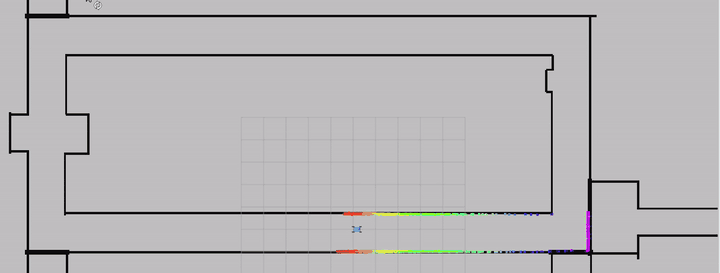
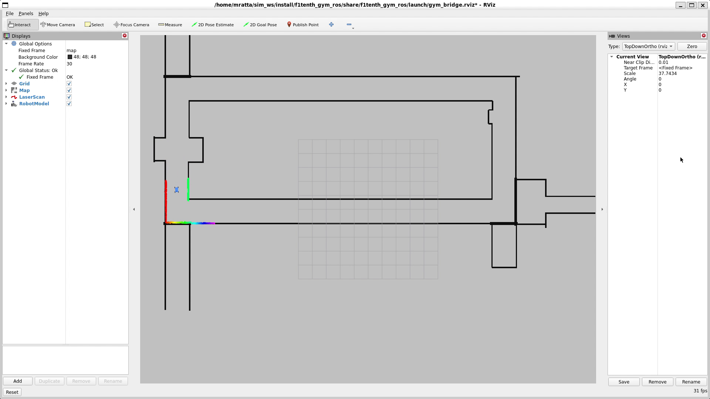

# RoboRacer Wall Following

A ROS 2 Humble C++ node that uses simulated LiDAR data and a PID controller to keep a RoboRacer vehicle a fixed distance from the wall and drive it autonomously around the Levine Hall loop.



## What the node does

1. Subscribes to `/scan` to receive LiDAR range measurements.
2. Reads two beams on the left side of the car: one straight out at 90° (`b`) and one 50° further forward (`a`).
3. Calculates the car's angle to the wall, `α = atan((a·cos θ − b) / (a·sin θ))`, and its current distance, `D = b·cos α`.
4. Projects the distance 1 m ahead, `D_future = D + L·sin α`, so the car corrects before it reaches a turn.
5. Runs the error (`D_future − desired distance`) through a PID controller to get a steering angle.
6. Picks a speed from the steering angle: 1.5 m/s on straights, 1.0 m/s between 10° and 20°, and 0.5 m/s in sharp turns.
7. Publishes the steering angle and speed as an Ackermann command to `/drive`.

### Doorway handling

To two side beams, an open doorway looks like a corner, because the wall suddenly disappears. The node checks the beam straight ahead to tell them apart: at a corner there is a wall in front of the car; at a doorway it is open. When the path ahead is open, the node limits how far a sudden gap can pull the car sideways, so it drives past the door recesses instead of turning into them.

## Tuned values

| Parameter | Value | Purpose |
|---|---|---|
| `kp` | 1.0 | Steering per metre of error |
| `kd` | 0.1 | Damps side-to-side wobble |
| `ki` | 0.0 | Not needed in simulation |
| Desired distance | 1.0 m | Distance kept from the left wall |
| Look-ahead `L` | 1.0 m | How far ahead the distance is projected |
| Beam angle `θ` | 50° | Angle between beams `a` and `b` |

All values are hardcoded in `wall_follow/src/wall_follow_node.cpp`, so the node runs with a plain `ros2 run` and no parameter file.

## System

- Ubuntu 22.04 on WSL 2
- ROS 2 Humble
- C++
- F1TENTH Gym ROS simulator
- RViz
- `colcon`

## Map

The simulator's standard `levine` map has open exits leading out of the loop. `maps/levine_blocked.png` is a copy with those exits closed off so the car stays on the loop. The door recesses in the west hallway are kept, because they are the part that tests the doorway handling. To use it, copy both `maps/levine_blocked.*` files into `f1tenth_gym_ros/maps/` and set `map_path` in `f1tenth_gym_ros/config/sim.yaml` to point at `levine_blocked`.

## Build

Place this repository inside the `src` directory of a ROS 2 workspace, then run:

```bash
source /opt/ros/humble/setup.bash
cd ~/sim_ws
colcon build --packages-select wall_follow
source install/local_setup.bash
```

## Run

Launch the F1TENTH simulator in one terminal:

```bash
source /opt/ros/humble/setup.bash
source ~/sim_ws/install/local_setup.bash
ros2 launch f1tenth_gym_ros gym_bridge_launch.py
```

Run the wall-following node in a second terminal:

```bash
source /opt/ros/humble/setup.bash
source ~/sim_ws/install/local_setup.bash
ros2 run wall_follow wall_follow_node
```

The car starts driving immediately, counter-clockwise around the loop, following the inner (left) wall.

## Result

The car completes full counter-clockwise laps of Levine without touching a wall, slowing down for corners and driving past the door recesses in the west hallway.



Full demonstration video: [YouTube](https://youtu.be/68xQbCQoboE)

## Key learning

This project introduced me to PID control, including how each of the P, I and D terms changes the car's behaviour; using trigonometry on LiDAR beams to estimate distance and heading relative to a wall; predicting the car's future position to make up for its response delay; and handling an edge case (doorways vs. corners) using extra sensor information.

## Credits

Starter package from [f1tenth/f1tenth_lab3_template](https://github.com/f1tenth/f1tenth_lab3_template) (MIT license). The lab was completed as part of the TMU Velocity Design Team's RoboRacer training.
